# Week 3 Task Report: Enhancing User Experience with Accessibility

**Intern:** Pranav Jadhav  
**Internship:** Junior Frontend Developer Internship (Yuva Intern)  
**Project:** SoleStyle Journal (blog / information portal)  
**Folders:** `before/` (starting page), `after/` (accessible page), `audit/` (reports), `screenshots/`

## 1. Objective and Page Concept

Week 3 asks for a typical blog or information portal page to be audited and then reworked so that it follows WCAG and ARIA guidelines: semantic HTML, correct ARIA, keyboard access, visible focus and good contrast. I chose "SoleStyle Journal", a sneaker-care blog that belongs to the SoleStyle brand I built in Weeks 1 and 2. The page has a header with navigation, search and a submenu, a featured article, topic filters, six article cards, a data table, an FAQ and a newsletter pop-up. Together these cover most of the interactive patterns a real information portal needs.

How the audit was set up: the starting page ("before") was written the way many first-draft pages are written, with the common mistakes that Lighthouse and WAVE reports usually show. It lives in the before/ folder. The reworked page ("after") is in the after/ folder. Both pages have identical content, so every difference in the results comes from accessibility changes alone.

## 2. Tools and Method

| Tool / method | How I used it |
|---|---|
| Lighthouse 13.5.0 | Accessibility category, run on both pages from the command line. Full HTML and JSON reports are in the audit/ folder. |
| axe-core 4.14.0 | Run on both pages with the WCAG 2.0, 2.1, 2.2 (A and AA) and best-practice rule sets. Results are in audit/axe-before.json and audit/axe-after.json. |
| Keyboard testing | Scripted tests in Chromium (Playwright) that press Tab, Shift+Tab, Enter, Space, Esc and arrow keys and record where focus goes (audit/manual-tests.json). |
| Pixel contrast check | For text that sits on a picture, automated tools cannot decide. I hid the text, took a screenshot behind it, found the lightest pixel and calculated the real ratio at four screen widths. |
| Reflow, text spacing, reduced motion | Checked at 320 px width (the same as 400% zoom on a 1280 px screen), with WCAG text-spacing values applied, and with "prefers-reduced-motion" switched on. |
| Accessibility tree | Captured from the browser to see the names and roles that a screen reader receives. |

Limits of this audit: WAVE is a browser extension, so I could not run it here, and I did not test with a real screen reader such as NVDA or VoiceOver; I used the browser’s accessibility tree instead. All tests ran in Chromium only. Automated tools also find only part of the problems, which is why the keyboard tests in Section 3 matter.

## 3. Accessibility Audit of the Starting Page (Before)

### 3.1 Automated results

| Lighthouse audit | WCAG | Elements | Meaning |
|---|---|---|---|
| color-contrast | 1.4.3 | 50 | Text colour is too close to the background |
| html-has-lang | 3.1.1 | 1 | Page has no language |
| image-alt | 1.1.1 | 7 | Images have no alt text |
| landmark-one-main | 2.4.1 / 1.3.1 | 1 | No main landmark |
| meta-viewport | 1.4.4 | 1 | Zooming is disabled |
| tabindex | 2.4.3 | 1 | A positive tabindex changes the focus order |
| td-has-header | 1.3.1 | 1 | Data table has no header cells |

Lighthouse accessibility score: 54 out of 100 (7 audits failed, 8 passed). axe-core found 8 failing rules on 80 elements. Besides the Lighthouse items, axe also reported: page-has-heading-one (1), region (18).

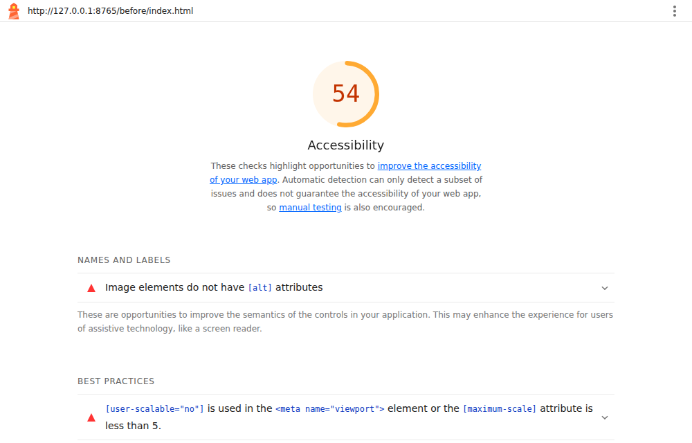
*Figure 1: Lighthouse report for the starting page.*

### 3.2 Problems that automated tools did not report

The keyboard tests showed much more. A page can pass many automatic checks and still be unusable without a mouse:

| Test | Result on the starting page |
|---|---|
| Click-only controls | 11 of 12 controls that react to clicks cannot be reached with the Tab key (menu button, search icon, 4 filters, 3 FAQ questions, close button, form button). |
| Tab stops on the whole page | 15 stops, and the first one is "Subscribe" because it has tabindex="3"; the order does not match the visual order. |
| Visible focus | outline-style on a focused link is "none": keyboard users cannot see where they are. |
| Submenu "Guides" | Shows only on mouse hover. When the link has keyboard focus the submenu stays display: none. |
| Newsletter pop-up | Cannot be opened with Enter (opened: false). When opened with the mouse, Esc does not close it (closed: false), focus stays on the page behind, and nothing tells a screen reader that a dialog opened. |
| Form error | Shows "Invalid" in red only. It is not linked to the field (aria-describedby or aria-invalid present: false) and has no suggestion for fixing it. |
| Status messages | 0 live regions. Filtering articles changes "6 articles" silently, so screen reader users get no feedback. |
| Mobile menu | The hamburger is a <div>; focusable by keyboard: false. |
| Zoom | user-scalable=no is set: true. People with low vision cannot pinch-zoom. |
| Hero text on the picture | Measured behind the text at 320, 375, 768 and 1280 px: worst case 1.0:1 (white text crosses the white sneaker, so parts of the heading disappear). Needs 4.5:1. |
| Touch target size | 20 of 23 interactive elements are smaller than 44 × 44 px. |

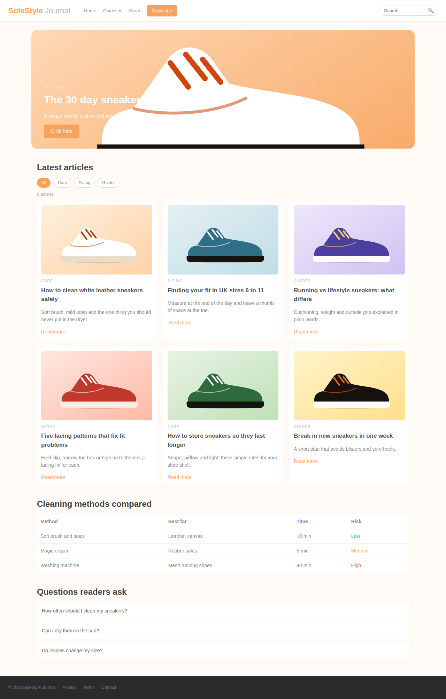
*Figure 2a: Starting page. Note the hero text lost over the picture.*

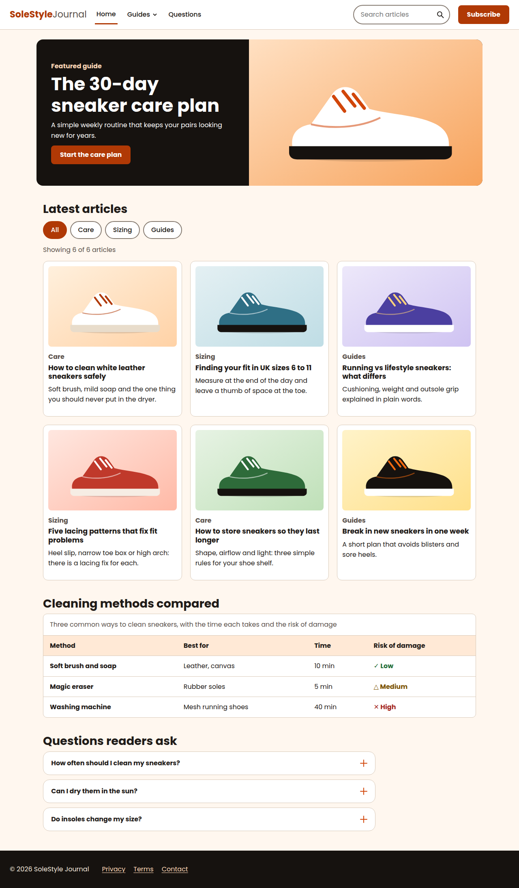
*Figure 2b: Reworked page, same content.*

## 4. Improvements Made and Why They Help

Each row links a problem to the WCAG success criterion it breaks, the fix, and the measured result.

| Problem found | WCAG | Fix applied | Result |
|---|---|---|---|
| No lang attribute | 3.1.1 | <html lang="en"> so screen readers choose the right voice and pronunciation | html-has-lang: fail → pass |
| Page title was "Home" | 2.4.2 | Descriptive title: "SoleStyle Journal: sneaker care, sizing and fit guides" | Title identifies the page in tabs and history |
| Zoom disabled | 1.4.4 | Removed maximum-scale=1 and user-scalable=no | meta-viewport: fail → pass |
| Div-only layout, no landmarks | 1.3.1, 2.4.1 | header, nav (labelled "Main" and "Footer"), main, section with headings, footer, role=search. Added a "Skip to main content" link | landmark-one-main and region (18 elements) → pass; skip link is the first Tab stop |
| No h1; h4 used as the title | 1.3.1, 2.4.6 | One h1, then h2 sections and h3 article titles in order | page-has-heading-one → pass; 13 headings in correct order |
| 7 images without alt text | 1.1.1 | Meaningful alt text on all 7 images, with width and height set | image-alt: 7 failures → 0 (7/7 have alt) |
| Low contrast text (50 elements) | 1.4.3 | New colour tokens (Section 6): dark ink, darker orange, larger text | color-contrast: 50 failures → 0 |
| Hero text on top of a picture | 1.4.3 | Text moved to a solid dark panel next to the picture | Worst case 1.0:1 → 14.1:1 at every width tested (Section 9) |
| Links use colour only; "Click here" and "Read more" | 1.4.1, 2.4.4 | Links are underlined; each article title is the link, and the whole card is clickable; button text says "Start the care plan" | Link purpose is clear out of context |
| Focus outline removed with outline: none | 2.4.7 | 3 px dark ring with a white halo on every control | Computed outline: solid 3px |
| 11 click-only <div> controls | 2.1.1, 4.1.2 | Replaced with real <button> and <a> elements | Every control is a Tab stop and works with Enter/Space |
| Icon-only buttons (menu, search) had no name | 4.1.2 | SVG icons marked aria-hidden, text in a visually hidden span | Accessible names: "Menu", "Search" |
| Hover-only submenu | 2.1.1, 1.4.13 | Disclosure button with aria-expanded and aria-controls; Esc closes it and returns focus; Tab out closes it | Works by keyboard (Section 5) |
| Mobile menu button state unknown | 4.1.2 | Button with aria-expanded and aria-controls; Esc closes and returns focus | expanded: true → Esc → false |
| Filters and search change results silently | 4.1.3, 4.1.2 | Filter buttons use aria-pressed; a role="status" line announces "Showing 2 of 6 articles" and an empty-state message | Showing 2 of 6 articles |
| Fake accordion with divs | 4.1.2 | Reused my Week 2 Accordion component (aria-expanded, aria-controls, keyboard) | Enter toggles: aria-expanded=true |
| Table without headers; risk shown by colour only | 1.3.1, 1.4.1 | caption, th scope="col" and scope="row"; risk written as text with a symbol; scroll area has a name and is focusable | td-has-header → pass |
| Pop-up without dialog semantics | 2.1.2, 2.4.3, 4.1.2 | Native <dialog> opened with showModal(): labelled, focus moves in, page behind is inert, Esc closes, focus returns to the Subscribe button | Esc closes: true; focus returned to #openSub |
| Form: no label, vague error | 1.3.5, 3.3.1, 3.3.2, 3.3.3 | Real <label>, type=email, autocomplete=email; error text linked with aria-describedby, aria-invalid, focus moved to the field, message says how to fix it | Error: "Enter your email address, for example name@example.com." |
| Positive tabindex | 2.4.3 | Removed; DOM order matches visual order | tabindex audit: fail → pass |
| Tiny touch targets | 2.5.8 | Minimum 44 × 44 px for buttons, links and fields | 20 of 23 small → 0 of 26 |
| Constant pulsing animation | 2.2.2, 2.3.3 | Removed; prefers-reduced-motion turns off all transitions | Transition duration: 0s |

### 4.1 Code examples (before and after)

Mobile menu button. Before, the control is a <div> that keyboards and screen readers cannot use; after, it is a button with a name and a state:

```
<!-- BEFORE -->
<div class="menu-btn" onclick="toggleMenu()">&#9776;</div>

<!-- AFTER -->
<button class="menu-btn" id="menuBtn" type="button"
        aria-expanded="false" aria-controls="siteNav">
  <svg aria-hidden="true" focusable="false" ...></svg>
  <span class="sr">Menu</span>
</button>
```
*Snippet 1: index.html, header.*

Filter buttons and the live status message:

```
<div class="chips" role="group" aria-label="Filter articles by topic">
  <button type="button" class="chip" data-cat="all" aria-pressed="true">All</button>
  <button type="button" class="chip" data-cat="care" aria-pressed="false">Care</button>
</div>
<p class="count" id="count" role="status">Showing 6 of 6 articles</p>
```
*Snippet 2: after/index.html. script.js updates aria-pressed and the status text on every change.*

Error handling in the subscribe form (script.js). The message is text, is linked to the field, and focus moves to the field:

```
if (msg) {
  err.textContent = msg; err.hidden = false;
  email.setAttribute('aria-invalid', 'true');   // field is announced as invalid
  email.focus();                                  // user lands on the problem
  return;
}
```
*Snippet 3: after/script.js. The input has aria-describedby="emailErr", so the message is read together with the field.*

Focus styles and the skip link (style.css):

```
:focus-visible { outline: 3px solid var(--focus); outline-offset: 3px; box-shadow: 0 0 0 6px #fff; }
.skip { position: absolute; left: .5rem; top: -4rem; ... }
.skip:focus { top: .5rem; }              /* appears when it receives focus */
@media (prefers-reduced-motion: reduce) {
  *, *::before, *::after { transition: none !important; animation: none !important; }
}
```
*Snippet 4: after/style.css.*

Accessible table:

```
<table>
  <caption>Three common ways to clean sneakers, ...</caption>
  <thead><tr><th scope="col">Method</th><th scope="col">Best for</th> ...</tr></thead>
  <tbody><tr><th scope="row">Soft brush and soap</th><td>Leather, canvas</td> ...
    <td><span class="risk low">&#10003; Low</span></td></tr></tbody>
</table>
```
*Snippet 5: after/index.html. Risk is shown with words and symbols, not colour alone.*

## 5. Keyboard, ARIA and Screen Reader Testing (After)

Tab order of the reworked page, in the order focus moves (26 stops, matching the visual order):

1) Skip to main content; 2) SoleStyle Journal, back to top; 3) Home; 4) Guides; 5) Questions; 6) Search articles; 7) Search; 8) Subscribe; 9) Start the care plan; 10) All; 11) Care; 12) Sizing; 13) Guides; 14) How to clean white leather sneakers sa; 15) Finding your fit in UK sizes 6 to 11; 16) Running vs lifestyle sneakers: what di; 17) Five lacing patterns that fix fit prob; 18) How to store sneakers so they last lon; 19) Break in new sneakers in one week; 20) Cleaning methods table, scrollable; 21) How often should I clean my sneakers?; 22) Can I dry them in the sun?; 23) Do insoles change my size?; 24) Privacy; 25) Terms; 26) Contact.

| Test | What I did | Result |
|---|---|---|
| Skip link | Pressed Tab once, then Enter, then Tab | First stop: "Skip to main content", visible on focus: true; next stop after Enter: "Start the care plan" (header skipped) |
| Submenu | Enter on "Guides", Tab, Esc; then open and Tab out | aria-expanded=true → first link "Care"; Esc → expanded=false, focus back on "Guides"; Tab out → closed (expanded=false) |
| Mobile menu (375 px) | Enter on Menu button, then Esc | expanded=true and menu visible; after Esc expanded=false, focus on #menuBtn |
| Topic filter | Space on the "Care" button | aria-pressed: all=false, care=true, sizing=false, guides=false; status: "Showing 2 of 6 articles"; 2 cards visible |
| Search | Typed "lacing", then "zzzz" | "Showing 1 of 6 articles"; no match: "Showing 0 of 6 articles" and the empty-state message shown: true |
| Accordion | Enter on the first question | aria-expanded=true |
| Dialog: open | Enter on Subscribe | Dialog open: true; focus moved to "email" field |
| Dialog: focus containment | Pressed Tab 9 times | Focus order: BUTTON → cancelSub → BODY → closeSub → email … (BODY = browser toolbar); it never reached the page behind: true |
| Dialog: errors | Submitted empty, then "abc@", then a valid address | aria-invalid=true, describedby=emailErr, focus on #email; "This email looks incomplete. Use the format name@example.com."; success: "Thank you. You are subscribed and your first tip arrives on Monday." |
| Dialog: close | Esc | Closed: true; focus returned to #openSub |
| JavaScript errors | Console watched during all tests | 0 errors |

The accessibility tree for the header, which is what a screen reader receives, shows named landmarks, a labelled search and buttons with names:

```
- banner:
  - link "SoleStyle Journal, back to top":
    - /url: "#main"
    - text: SoleStyle Journal
  - navigation "Main":
    - list:
      - listitem:
        - link "Home":
          - /url: "#main"
      - listitem:
        - button "Guides"
      - listitem:
        - link "Questions":
          - /url: "#faq"
  - search:
    - text: Search articles
    - searchbox "Search articles"
    - button "Search"
  - button "Subscribe"
```
*Snippet 6: Accessibility tree captured with Playwright (ariaSnapshot).*

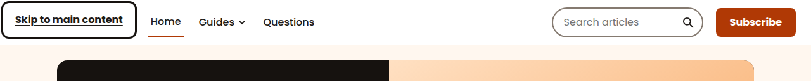
*Figure 3a: Skip link appears on the first Tab press.*

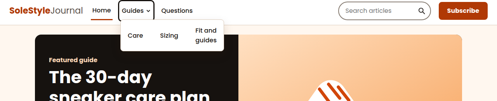
*Figure 3b: Submenu opened with Enter.*

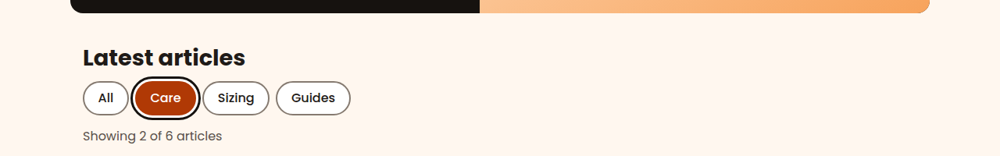
*Figure 3c: Focus ring on the "Care" filter and the live status message.*

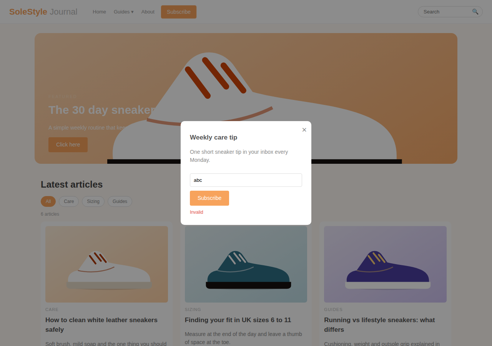
*Figure 4a: Before. Red "Invalid" only.*

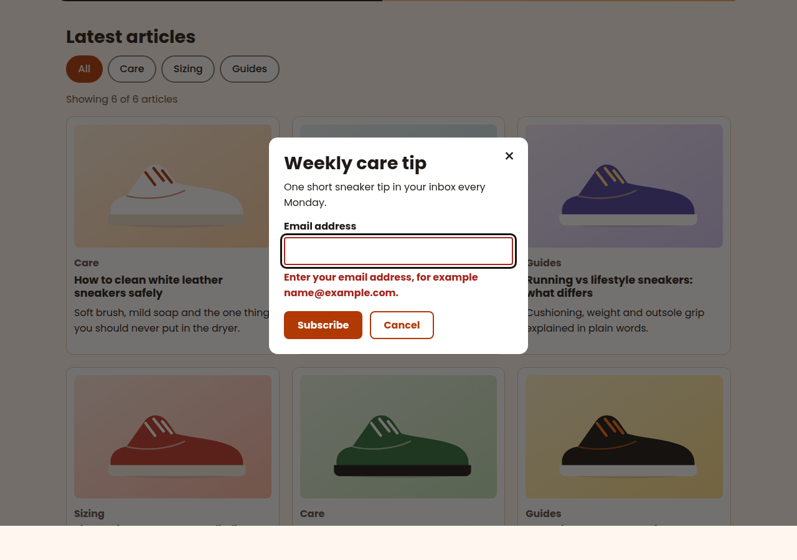
*Figure 4b: After. Dialog with a clear error message.*

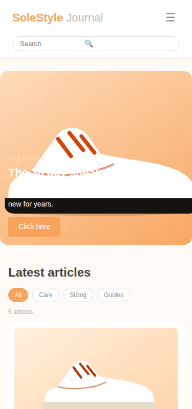
*Figure 5a: Mobile, before.*

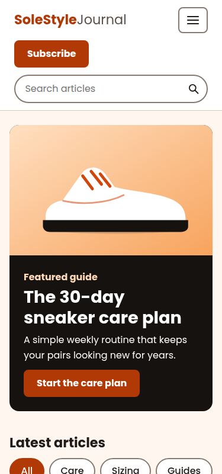
*Figure 5b: Mobile, after.*

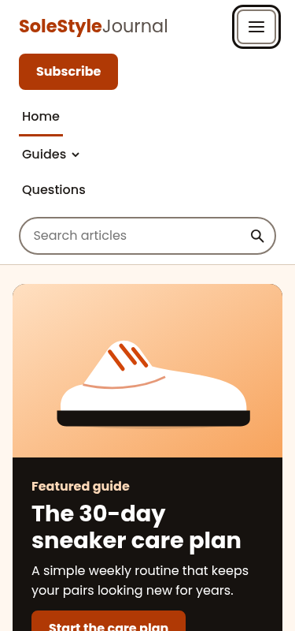
*Figure 5c: Menu open.*

## 6. Colour Contrast

Ratios were calculated with the WCAG formula. Text needs 4.5:1 (3:1 if it is 24 px or larger, or 19 px and bold); parts of controls such as borders and focus rings need 3:1.

| Before: element | Colours | Ratio | Needs 4.5:1 |
|---|---|---|---|
| Body text | #8A8A8A on #FFFAF5 | 3.3:1 | Fail |
| Category tags | #BBBBBB on #FFFFFF | 1.9:1 | Fail |
| Result count | #AAAAAA on #FFFFFF | 2.3:1 | Fail |
| Button, white text | #FFFFFF on #F7A35C | 2.0:1 | Fail |
| "Read more" links | #F7A35C on #FFFFFF | 2.0:1 | Fail |
| Nav links | #999999 on #FFFFFF | 2.8:1 | Fail |
| Risk "Low" (green) | #3DBB5D on #FFFFFF | 2.5:1 | Fail |
| Footer text | #777777 on #2B2B2B | 3.2:1 | Fail |

| After: element | Colours | Ratio | Needs |
|---|---|---|---|
| Body text | #1F1B18 on #FFF7EF | 16.1:1 | Pass |
| Secondary text | #5A514B on #FFFFFF | 7.7:1 | Pass |
| Buttons and selected filters, white text | #FFFFFF on #B03905 | 6.1:1 | Pass |
| Orange links and logo | #B03905 on #FFFFFF | 6.1:1 | Pass |
| Hero text | #FFFFFF on #16120F | 18.6:1 | Pass |
| Hero label | #FFD9B8 on #16120F | 14.1:1 | Pass |
| Footer text | #F3E9DE on #16120F | 15.5:1 | Pass |
| Footer links | #FFD9B8 on #16120F | 14.1:1 | Pass |
| Error message | #A3261C on #FFFFFF | 7.4:1 | Pass |
| Success message | #1C6B34 on #FFFFFF | 6.6:1 | Pass |
| Risk "Medium" | #7A5200 on #FFFFFF | 6.9:1 | Pass |
| Focus ring (UI part) | #16120F on #FFF7EF | 17.6:1 | Pass |
| Search, filter and field borders (UI part) | #857A70 on #FFFFFF | 4.2:1 | Pass |
| Form field border (UI part) | #6B6058 on #FFFFFF | 6.1:1 | Pass |

## 7. Responsive, Zoom and Motion Checks

| Check | Result |
|---|---|
| Reflow at 320 px (WCAG 1.4.10) | Horizontal scroll: false (page width 320 px). The table scrolls inside its own labelled box. |
| Pinch zoom allowed (1.4.4) | Viewport blocks zoom: false |
| Text spacing (1.4.12) | Line height 1.5, letter spacing 0.12 em, word spacing 0.16 em applied: horizontal scroll false, hero text clipped false |
| Reduced motion (2.3.3) | Transition duration with the setting on: 0s |
| Touch target size (2.5.8) | 0 of 26 interactive elements are under 44 × 44 px. Article-title links are excluded because their clickable area is the whole card. |

## 8. Results: Before and After

| Measure | Before | After |
|---|---|---|
| Lighthouse accessibility score | 54 / 100 | 100 / 100 |
| Lighthouse failed audits | 7 | 0 |
| axe-core failing rules / elements | 8 rules / 80 elements | 0 rules / 0 elements |
| axe-core rules passed | 18 | 51 |
| Controls reachable by keyboard | 1 of 12 click handlers | All |
| Keyboard tab stops | 15 | 26 |
| Visible focus indicator | None | solid 3px |
| Live status regions | 0 | 2 |
| Images with alt text | 0 of 7 | 7/7 |
| Small touch targets | 20 of 23 | 0 of 26 |

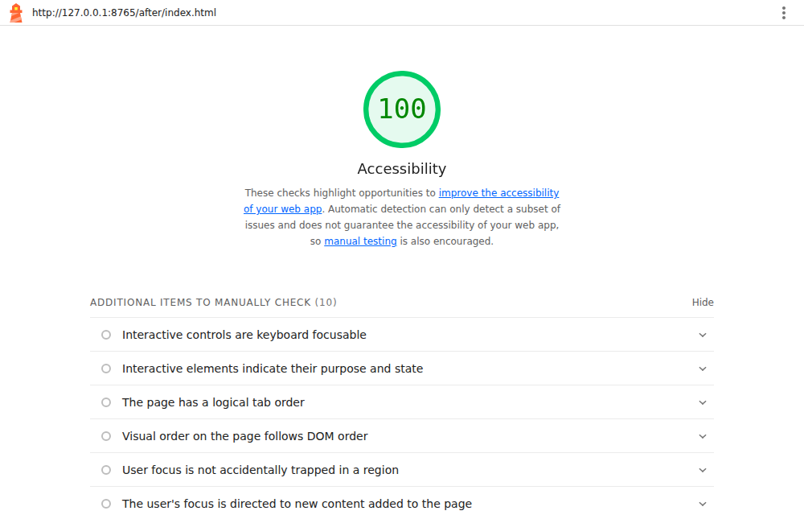
*Figure 6: Lighthouse report for the reworked page.*

## 9. Challenges and What I Learned

- Text on a picture cannot be checked by axe-core, which marked colour contrast as "needs review". My first version put the hero text over the image with a dark gradient. Measuring the real pixels showed ratios of only 1.4:1 at 320 and 375 px, 3.3:1 at 768 px and 4.2:1 for the small label at 1280 px. I redesigned the hero so the text sits on a solid dark panel, and the worst ratio became 14.1:1 at every width.
- My reflow test caught a real fault: at 320 px the page scrolled sideways (404 px wide) because the search field could not shrink. Adding min-width: 0 fixed it, and the page is now exactly 320 px wide.
- axe-core reported "landmark-unique" because the scrollable table and its section had the same label. I gave the table region its own name.
- Target sizes: the logo link was 36 px tall and the search field 40 px. Both are now 44 px.
- Focus-trap test: Tab inside a native dialog moves from the last control to the browser toolbar and then back to the first control. This is correct behaviour, not a trap, and the page behind never receives focus.
- Making whole article cards clickable without creating two links per card: the title link stretches over the card with ::after, and the focus ring is drawn around the card where :has() is supported (with @supports), otherwise around the link.
- Main lesson: automatic tools gave a score, but only the keyboard tests showed that 11 controls were unusable without a mouse. I now test with the keyboard first.

## 10. WCAG Criteria Addressed

1.1.1 Non-text content; 1.3.1 Info and relationships; 1.3.5 Identify input purpose; 1.4.1 Use of colour; 1.4.3 Contrast (minimum); 1.4.4 Resize text; 1.4.10 Reflow; 1.4.11 Non-text contrast; 1.4.12 Text spacing; 1.4.13 Content on hover or focus; 2.1.1 Keyboard; 2.1.2 No keyboard trap; 2.2.2 Pause, stop, hide; 2.3.3 Animation from interactions; 2.4.1 Bypass blocks; 2.4.2 Page titled; 2.4.3 Focus order; 2.4.4 Link purpose; 2.4.6 Headings and labels; 2.4.7 Focus visible; 2.5.8 Target size (minimum); 3.1.1 Language of page; 3.3.1 Error identification; 3.3.2 Labels or instructions; 3.3.3 Error suggestion; 4.1.2 Name, role, value; 4.1.3 Status messages.

## 11. Conclusion

The reworked SoleStyle Journal moved from a Lighthouse score of 54 to 100, from 8 failing axe-core rules to 0, and from a page that could not be used by keyboard to one where every control can be reached, seen and operated. The strongest evidence is in the keyboard and ARIA tests, the measured contrast ratios and the before and after screenshots. The next step I would take is to test with a real screen reader and with WAVE in the browser.

